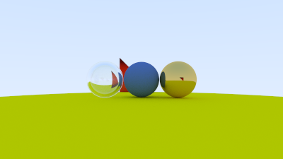

# Ray Tracing Engine

A CPU-based ray tracing engine written in **C++** to explore the mathematics and programming behind rendering 3D scenes. The project traces rays through a virtual camera, calculates intersections with objects, and simulates how light interacts with different materials.

This is an ongoing learning project, with features being added as the renderer develops.

## Example Render



*The image above is generated by the renderer and saved as `image.png`.*

## Features

- **Ray-object intersections:** Spheres and triangles
- **Materials:** Diffuse (Lambertian), metallic, and dielectric (glass-like) surfaces
- **Recursive ray tracing:** Reflection, refraction, and multiple ray bounces
- **Anti-aliasing:** Multiple randomized samples per pixel
- **Camera settings:** Aspect ratio, resolution, field of view, viewing direction, focus distance, and optional depth-of-field effects
- **Image output:** PPM rendering with PNG conversion using Python and Pillow
- **Color processing:** Sample averaging and gamma correction

## Requirements

- C++ compiler such as `g++` (C++17 support)
- Python 3
- [Pillow](https://pillow.readthedocs.io/) for image conversion
- [Fish shell](https://fishshell.com/) to use the included run script

Install Pillow using:

```bash
python3 -m pip install Pillow
```

## Getting Started

### 1. Clone the Repository

```bash
git clone https://github.com/SeanFjellman/rayTracingEngine.git
cd rayTracingEngine
```

### 2. Run the Engine

If you have Fish installed, use the included run script:

```bash
fish run
```

The script will:

1. Compile the C++ ray tracer.
2. Execute the program to generate `image.ppm`.
3. Convert the PPM image into `image.png`.

Alternatively, compile and run manually:

```bash
g++ -std=c++17 -O3 main.cc -o raytracer
./raytracer
python3 convertImage.py
```

### 3. View the Output

The generated files are saved in the project directory.

| File | Description |
|------|-------------|
| `image.ppm` | Raw rendered image |
| `image.png` | Converted PNG image |

**Note:** Higher sample counts and resolutions will increase rendering time.

## Customizing the Scene

The scene and camera settings can be modified in `main.cc`.

Example camera settings:

```cpp
cam.aspect_ratio = 16.0 / 9.0;
cam.image_width = 400;
cam.samples_per_pixel = 1000;
cam.max_depth = 50;
cam.vfov = 40;
cam.defocus_angle = 0;
cam.focus_dist = 3.4;
```

### Camera Parameters

| Parameter | Description |
|-----------|-------------|
| `aspect_ratio` | Controls the width-to-height ratio |
| `image_width` | Sets the horizontal image resolution |
| `samples_per_pixel` | Number of rays sampled per pixel |
| `max_depth` | Maximum number of ray bounces |
| `vfov` | Vertical field of view |
| `lookfrom` | Camera position |
| `lookat` | Point the camera faces |
| `vup` | Camera's upward direction |
| `defocus_angle` | Controls depth-of-field effects |
| `focus_dist` | Distance to the focus plane |

**Implementation note:** The current camera implementation contains a hard-coded camera origin in `camera.h`. This should be removed to allow `lookfrom` to control the camera position.

## Project Structure

| File | Description |
|------|-------------|
| `main.cc` | Main program, scene setup, and camera configuration |
| `camera.h` | Camera configuration and ray generation |
| `ray.h` | Ray representation |
| `vec3.h` | 3D vector mathematics |
| `hittable.h` | Base interface for intersectable objects |
| `hittable_list.h` | Collection of scene objects |
| `sphere.h` | Ray-sphere intersection calculations |
| `triangle.h` | Ray-triangle intersection calculations |
| `material.h` | Material properties and ray scattering |
| `color.h` | Color processing and output |
| `interval.h` | Interval calculations |
| `rtweekend.h` | Common mathematical utilities |
| `convertImage.py` | Converts PPM images to PNG |
| `run` | Fish script for compilation and execution |

## How Ray Tracing Works

Ray tracing simulates the behavior of light by tracing rays through a virtual scene.

### 1. Ray Generation

The camera generates rays that pass through pixels in the image.

### 2. Object Intersections

Each ray is tested against objects in the scene to determine whether an intersection occurs.

Currently supported geometry includes:

- Spheres
- Triangles

### 3. Material Interactions

When a ray intersects an object, its material determines how the ray behaves.

Supported materials include:

- **Diffuse:** Scatters light in randomized directions.
- **Metal:** Reflects incoming rays.
- **Dielectric:** Simulates transparent materials such as glass through reflection and refraction.

### 4. Recursive Ray Tracing

Rays continue bouncing through the scene until they reach the maximum recursion depth or no longer intersect an object.

### 5. Image Generation

The engine averages multiple samples per pixel and applies gamma correction before writing the resulting colors to a PPM image.

The PPM image can then be converted into PNG format for easier viewing.

## Planned Improvements

This project is actively being developed. Planned features include:

- [x] Ray-sphere intersections
- [x] Ray-triangle intersections
- [x] Diffuse materials
- [x] Metallic materials
- [x] Dielectric materials
- [x] Anti-aliasing
- [x] Configurable camera
- [x] PPM image output
- [x] PNG conversion
- [ ] Texture mapping for spheres
- [ ] Texture mapping for triangles
- [ ] Loading 3D mesh files
- [ ] Acceleration structures for improved performance
- [ ] Additional lighting and material options
- [ ] Further performance optimizations

## Learning Resources

This project explores concepts covered in:

[Ray Tracing in One Weekend](https://raytracing.github.io/)

The project serves as an opportunity to gain hands-on experience with:

- Computer graphics
- 3D vector mathematics
- Object-oriented C++
- Ray-object intersection algorithms
- Light simulation
- Rendering performance

## Author

**Sean Fjellman**

[GitHub Profile](https://github.com/SeanFjellman)

---

*This project is a work in progress and will continue to evolve as new rendering techniques and features are implemented.*
